<h1 align="center"><a href="#" target="_blank">帝俊企业资源计划系统 (Dijun ERP)</a></h1>
<div align="center">
 <strong>
  下一代智能ERP系统
 </strong>
</div>
<br />

<div align="center">
  <!-- Crates version -->
  <a href="https://spring.io/projects/spring-boot#learn">
    
  </a>
 <a href="https://codecov.io/gh/wansenai/eairp" > 
     
 </a>
  <a href="#">
    
  </a>
  <!-- commits -->
  <a href="#">
    
  </a>
   <a href="">
    
  </a>
</div>
<br />

## 简介

**帝俊 ERP (Dijun ERP)** 是基于现代技术栈构建的下一代智能企业资源计划系统。在传统ERP业务功能的基础上，我们深度集成了GPT大模型能力，支持DeepSeek等多种模型扩展。系统不仅提供进销存、财务、生产等核心业务管理，还允许用户通过自然语言与系统交互，实现智能查阅、自动化表单提交等创新功能。

帝俊 ERP 旨在为个人和企业提供一个可高度定制、易于部署且完全免费的开源解决方案。

## 核心特性

- **智能交互**: 集成GPT能力，支持自然语言查询和业务操作。
- **全面管理**: 涵盖采购、销售、库存、财务、生产等全流程业务。
- **快速部署**: 支持Docker容器化部署，开箱即用。
- **开源免费**: 基于Apache-2.0/MIT双重许可，商业友好。

## 系统截图

<div align="center">
  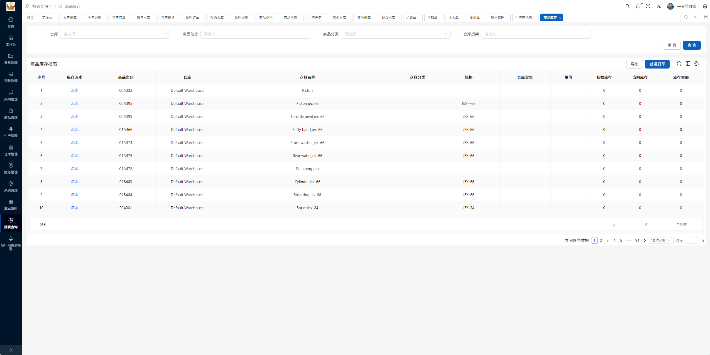
  <br/><br/>
  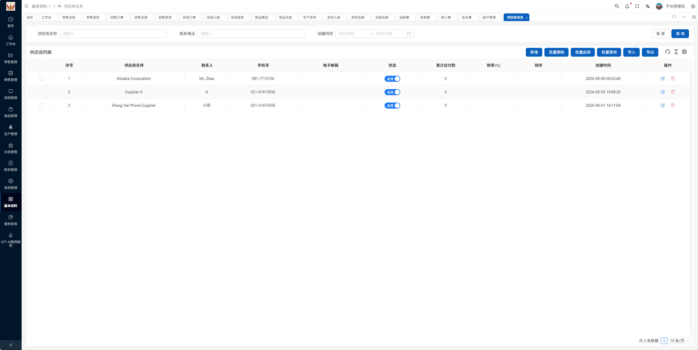
  <br/><br/>
  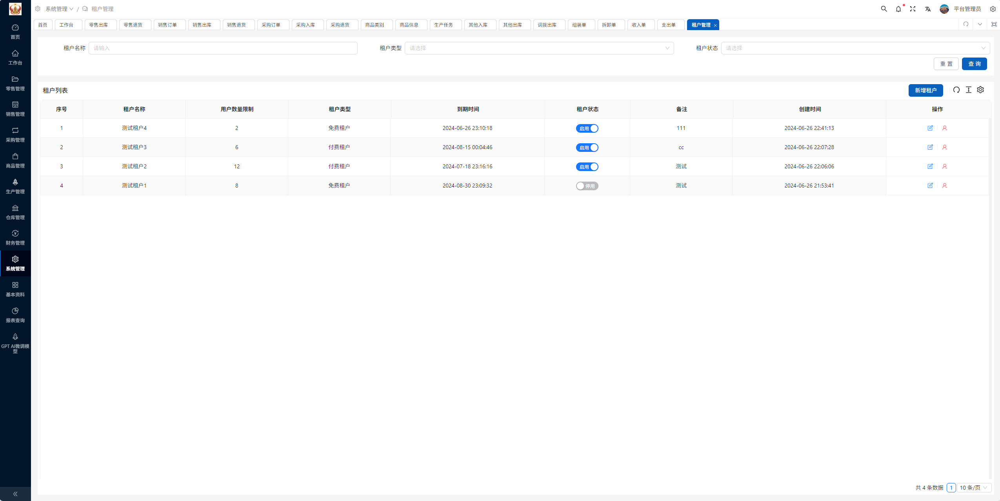
  <br/><br/>
  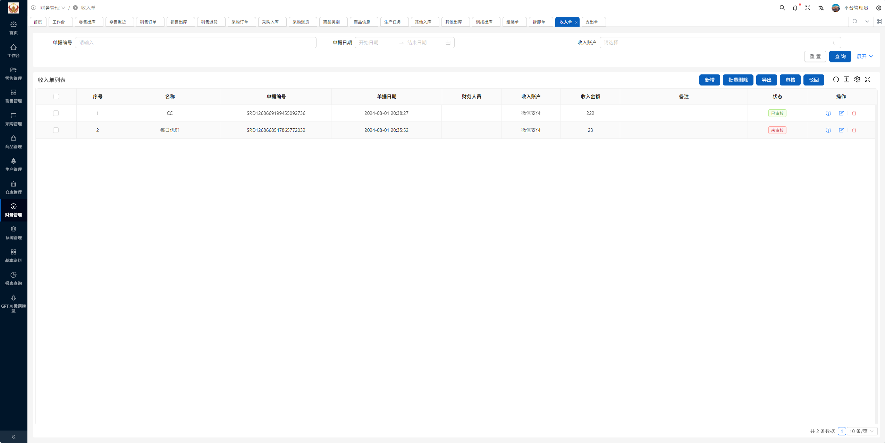
  <br/><br/>
  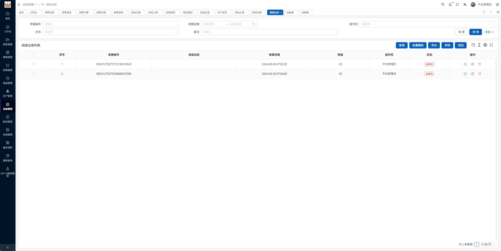
  <br/><br/>
  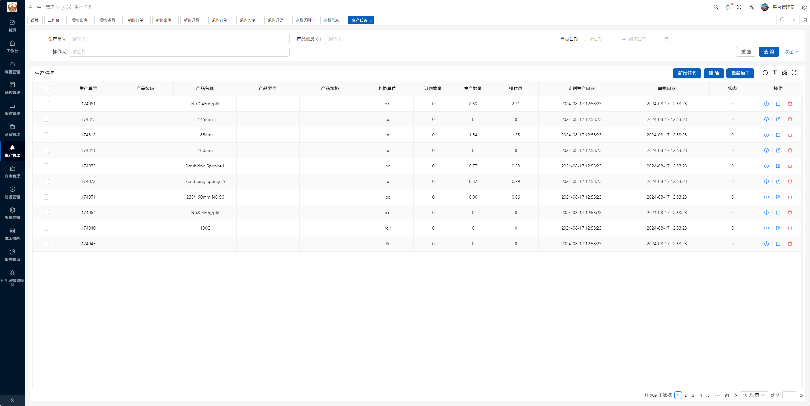
  <br/><br/>
  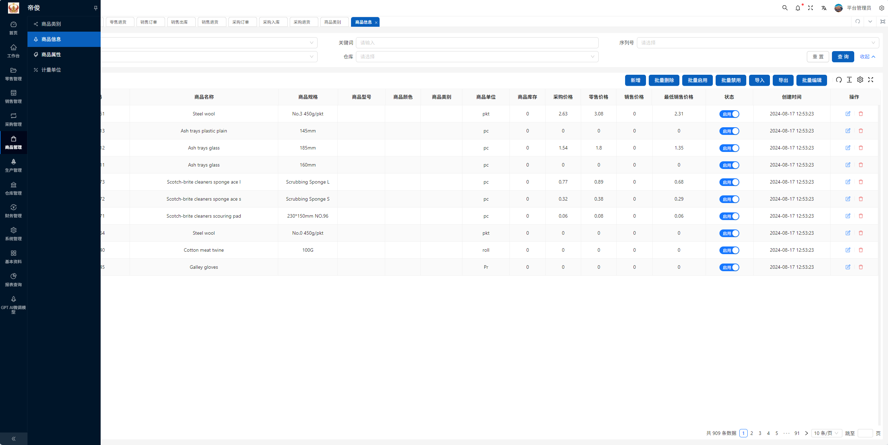
  <br/><br/>
  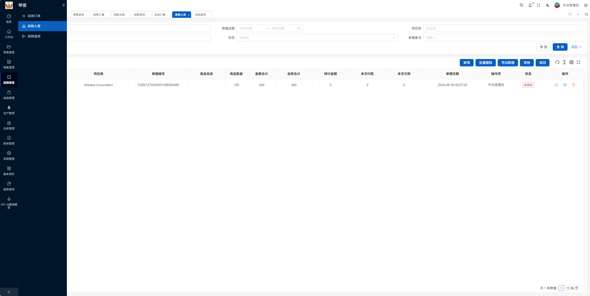
  <br/><br/>
  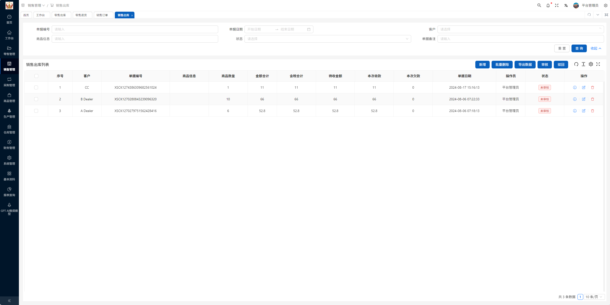
  <br/><br/>
  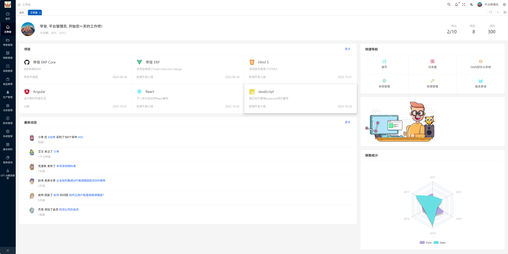
  <br/><br/>
  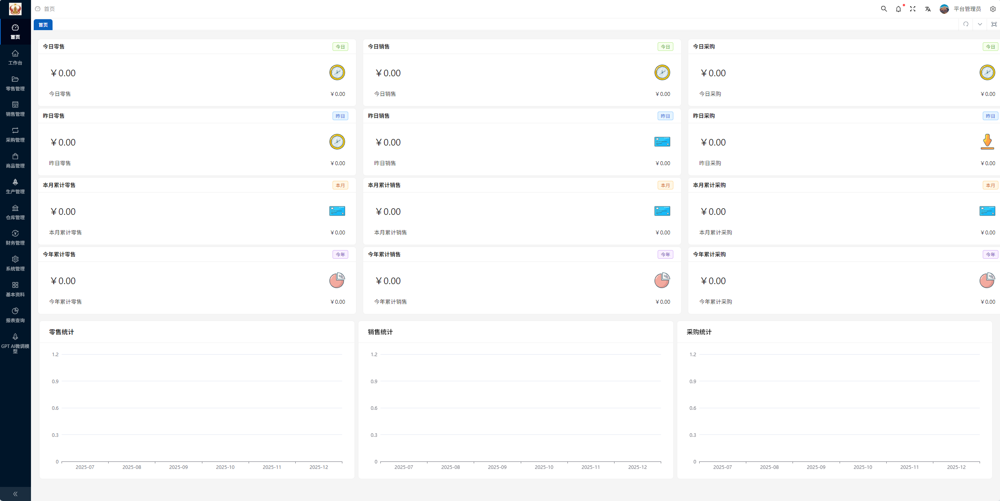
  <br/><br/>
  
</div>

## Online preview
- 测试账号: admin
- 测试密码: 123456

## 快速开始
我们提供了一种更全面的Docker部署方法，可以在[Docker](https://github.com/eairps/eairp/blob/master/docker/README_ZH.md)文件夹中找到

### 先决条件
- Docker Engine 20.10+
- Docker Compose v2.17+

### 1. Docker Compose（推荐）

**适用场景**: 本地没有MySQL/Redis环境，需要快速启动完整的服务栈。

```bash
# Clone deployment repository
git clone https://www.gitcc.com/glamechang/middlemist-di.git

cd middlemist-di

# Start services
docker compose up -d
```

### 2. Docker 独立容器

**适用场景**: MySQL/Redis服务已经存在，需要自定义数据库配置。

**步骤 1**: 创建专用网络

```console
docker network create eairp-net
```

**步骤 2**: 启动 MySQL 容器

```console
docker run -d --name mysql-eairp \
  --network eairp-net \
  -p 3306:3306 \
  -v /path/to/mysql:/var/lib/mysql \
  -e MYSQL_ROOT_PASSWORD=123456 \
  -e MYSQL_USER=eairp \
  -e MYSQL_PASSWORD=123456 \
  mysql:8.3 \
  --character-set-server=utf8mb4 \
  --collation-server=utf8mb4_bin
```

**步骤 3**: 启动 Redis 容器

```console
docker run -d --name redis-eairp \
  --network eairp-net \
  -p 6379:6379 \
  -v /path/to/redis/data:/data \
  redis:7.0 \
  redis-server --requirepass 123456
```

**步骤 4**: 启动 Dijun ERP 容器

配置参数：
|  环境变量	   | 说明  |  示例值  |  
|  ----  | ----  | ----  |
| SPRING_DATASOURCE_URL  | MySQL connection address | jdbc:mysql://mysql-eairp:3306/eairp |
| SPRING_REDIS_HOST	  | Redis host address | redis-eairp |
| API_BASE_URL		  | Front-end API basic path | http://your-domain.com/erp-api |

```console
docker run -d --name eairp \
  --network eairp-net \
  -p 3000:80 \
  -p 8088:8088 \
  -e SPRING_DATASOURCE_URL="jdbc:mysql://mysql-eairp:3306/eairp" \
  -e SPRING_DATASOURCE_USERNAME=eairp \
  -e SPRING_DATASOURCE_PASSWORD=123456 \
  -e SPRING_REDIS_HOST=redis-eairp \
  -e SPRING_REDIS_PASSWORD=123456 \
  wansenai/eairp:latest
```

## License

根据以下任一许可证之一，对本项目中的代码和文档进行许可：

- Apache License, Version 2.0, [LICENSE-APACHE](LICENSE-APACHE)
- MIT license [LICENSE-MIT](LICENSE-MIT)
根据您的选择。


## 贡献
我们欢迎每一位贡献者，无论是在代码还是文档方面。

除非您另有明确说明，否则有意提交以纳入 根据Apache-2.0许可证的定义，您的作品应具有上述双重许可，没有任何附加条款或条件。


## 网盘运行视频文件提取
通过网盘分享的文件：供应商对账 - 帝俊 - GPT浏览器 2025-12-18 19-22-36.mp4
链接: https://pan.baidu.com/s/1eHxa2Ko2YRWoBJ0GS_Zs0w 提取码: 3ky6 
--来自百度网盘超级会员v4的分享
